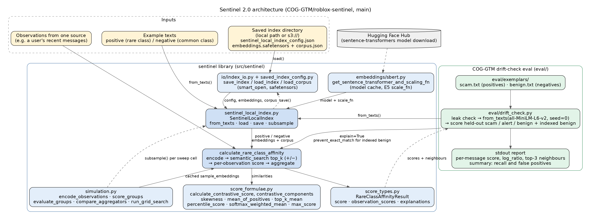

# Sentinel architecture

This page describes how the code on `main` fits together: the `sentinel` library in
`src/sentinel/`, how a score is produced, how indexes are saved and loaded, the
simulation harness, and the COG-GTM drift-check eval in `eval/`. For the public API
and usage examples, see the [README](../README.md) and [V2_FEATURES.md](../V2_FEATURES.md).



The diagram source is [`diagrams/architecture.dot`](diagrams/architecture.dot) (Graphviz).
After editing it, run `docs/diagrams/render.sh` to regenerate
[`architecture.png`](diagrams/architecture.png) and [`architecture.svg`](diagrams/architecture.svg).

## Modules

| Module | Role |
|---|---|
| `sentinel/__init__.py` | Public exports: `SentinelLocalIndex`, `RareClassAffinityResult`, the contrastive score and the aggregators. Package version `2.0.0`. |
| `sentinel/sentinel_local_index.py` | `SentinelLocalIndex`: holds the positive (rare class) and negative (common class) embeddings, their source texts and the sentence model. Builds (`from_texts`), saves (`save`), loads (`load`), resizes (`subsample`) and scores (`calculate_rare_class_affinity`). |
| `sentinel/embeddings/sbert.py` | `get_sentence_transformer_and_scaling_fn`: loads a `sentence-transformers` model (optionally cached) and returns a `scale_fn` for models whose similarities need rescaling (E5 family); `None` otherwise. |
| `sentinel/score_formulae.py` | Per-observation score (`calculate_contrastive_score`, built on `contrastive_components`) and the aggregators that turn many observation scores into one: `skewness` (default), `mean_of_positives`, `top_k_mean`, `percentile_score`, `softmax_weighted_mean`, `max_score`. |
| `sentinel/score_types.py` | `RareClassAffinityResult`: `rare_class_affinity_score`, `observation_scores`, `aggregation_name`, `aggregation_stats`, `explanations`. |
| `sentinel/io/index_io.py`, `sentinel/io/saved_index_config.py` | Persistence through `smart_open` (local paths and `s3://` URIs) and `safetensors`: `save_index`, `load_index`, `load_corpus`, and the `SavedIndexConfig` written alongside the embeddings. |
| `sentinel/simulation.py` | Offline tuning on labelled groups: `encode_observations`, `score_groups`, `evaluate_groups`, `compare_aggregators`, `run_grid_search`. |

## Building an index

`SentinelLocalIndex.from_texts(positive_texts, negative_texts, model_name="all-MiniLM-L6-v2", ...)`:

1. Copies the texts into `positive_corpus` / `negative_corpus`.
2. Loads the sentence model and `scale_fn` from `embeddings/sbert.py`.
3. If `neg_to_pos_ratio` is set, keeps a random subset of negatives (`len(positives) * ratio`),
   seeded by `seed` through a private `torch.Generator`.
4. Encodes both sides with `normalize_embeddings=True` (plus any `encoding_additional_kwargs`).

`subsample(n_positive, neg_to_pos_ratio, seed)` returns a smaller copy by taking rows of the
existing embeddings and their aligned texts, sharing the loaded model. It does not re-encode.

## Scoring: `calculate_rare_class_affinity`

Input is a list of observations from one source (for example a user's recent messages).

1. **Encode** each observation with the index's model, unless `sample_embeddings` are passed in
   (the simulation harness passes cached ones).
2. **Search** the positive and negative embeddings with `sentence_transformers.util.semantic_search`
   for the `top_k` nearest neighbours on each side, applying `scale_fn` when the model needs it.
   With `prevent_exact_match=True`, one extra neighbour is fetched and the top hit is skipped
   when its similarity is within `1e-3` of `1.0`, so texts that are already in the index can be
   scored without matching themselves.
3. **Per-observation score**: `calculate_contrastive_score` compares the positive and negative
   similarity terms and returns their log ratio, clipped to `0.0` when it is not positive.
4. **Threshold**: scores below `min_score_to_consider` (default `0.1`) become `0`.
5. **Aggregate** the observation scores with `aggregation_function` (default `skewness`) into
   `rare_class_affinity_score`. Skewness rewards a few strongly rare-class observations among
   many ordinary ones, which is the pattern Sentinel is built to surface.
6. **Explain** (`explain=True`): per observation, the contrastive terms
   (including `log_ratio_unclipped`) and, with `include_neighbors=True`, up to `neighbors_limit`
   matched neighbours with their sign (`+` positive, `-` negative), text and scaled score.

The result is a `RareClassAffinityResult`. Sentinel is meant as a high-recall candidate
generator; downstream review decides what a high score means.

## Persistence

`save(path)` writes three files to a local directory or S3 prefix:

| File | Contents |
|---|---|
| `sentinel_local_index_config.json` | Encoder model name, encoding kwargs and model card (`SavedIndexConfig`). |
| `embeddings.safetensors` | `positive_embeddings` and `negative_embeddings` tensors. |
| `corpus.json` | The original texts, so explanations name the matched sentence after a reload. |

`load(path, ...)` reads the config and embeddings, reads `corpus.json` when present (an
index saved without it, or with a corpus that does not match the embedding rows, loads with
no corpus), and reloads the sentence model and `scale_fn`.

## Simulation harness

`sentinel.simulation` measures which settings suit labelled data (`LabeledGroup`s of
observations with a 0/1 label):

- `encode_observations` encodes every observation once; `score_groups` produces the
  per-observation scores for each group, reusing those embeddings.
- `evaluate_groups` aggregates each group with one *summarize metric* (an aggregator) and
  reports three families of *evaluation metrics*: ranking, threshold/classification
  (best-F1 cutoff unless `decision_threshold` is given) and separation/distribution.
- `compare_aggregators` runs several aggregators over the same scores.
- `run_grid_search` sweeps `top_k`, `min_score_to_consider` and aggregators, and optionally
  index size and negative ratio through `subsample()`, encoding the observations only once.

## COG-GTM drift-check eval (`eval/`)

COG-GTM added a reproducible check for slang drift: scam messages written in new slang that
a moderator labelled as scams but that the index might score `0`.

| Path | Role |
|---|---|
| `eval/exemplars/scam.txt` | Positive exemplars (29 lines on `main`), one message per line. |
| `eval/exemplars/benign.txt` | Negative exemplars (52 lines on `main`). |
| `eval/drift_check.py` | The check. |

Run it from the repo root with:

```bash
PYTHONPATH=src python eval/drift_check.py
```

What it does:

1. Loads the non-empty lines of both exemplar files.
2. Exits with an error if any held-out message (below) appears in the exemplars, so the eval set
   never leaks into the index.
3. Builds the index with `SentinelLocalIndex.from_texts(scam, benign, model_name="all-MiniLM-L6-v2", seed=0)`.
   The model is downloaded from the Hugging Face Hub on first run.
4. Scores four groups with `calculate_rare_class_affinity(..., explain=True)`:
   - `HELD_OUT_SCAM`: four moderator-labelled scam messages in drifted slang (the script's
     comment calls them recall misses; with the exemplars on `main` all four are flagged).
   - `ALERT_MESSAGES`: the message quoted in the triggering alert, scored for reference.
   - `HELD_OUT_BENIGN`: six benign messages that share vocabulary with the scam ones (precision check).
   - The indexed benign exemplars themselves, with `prevent_exact_match=True`.
5. Prints, per message, the observation score, `FLAGGED` when the score is above `0`,
   `log_ratio_unclipped` and the top three neighbours, then a summary: scam recall, alert
   flagged, held-out benign false positives and indexed benign false positives.

A message counts as flagged when its observation score is above `0`, that is, after the
`min_score_to_consider` threshold of `0.1`. The script does not assert a target; read the
summary. Changing the exemplars or the model changes the result, so rerun it after editing
either file.

## Tests and CI

- `tests/` covers index construction, scoring, aggregators, persistence, embeddings and the
  simulation harness; CI (`.github/workflows/test.yml`) runs
  `poetry run pytest tests/ --cov=sentinel` with the `sbert` extra.
- `.github/workflows/docs.yml` checks that the generated Sphinx sources in `docs/source/`
  match the code (`docs/generate_docs.py`, also run by the `update-docs` pre-commit hook when
  `src/**/*.py` changes).
- The drift check is not run in CI.
